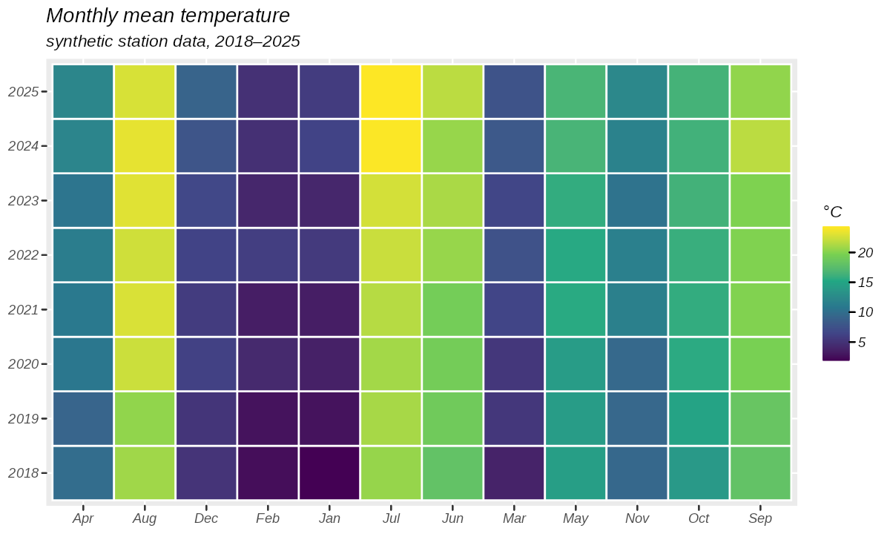
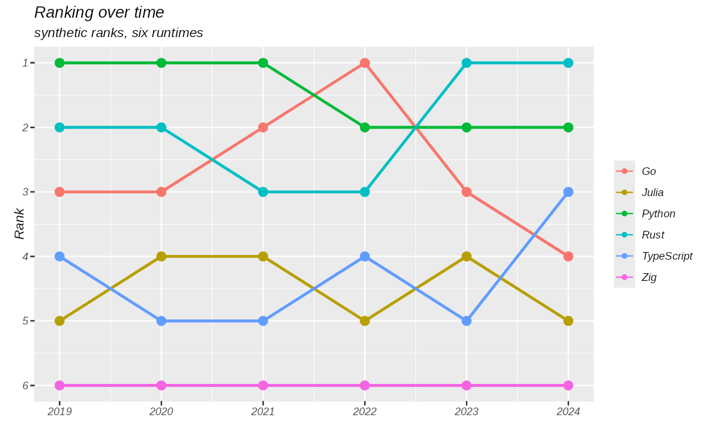
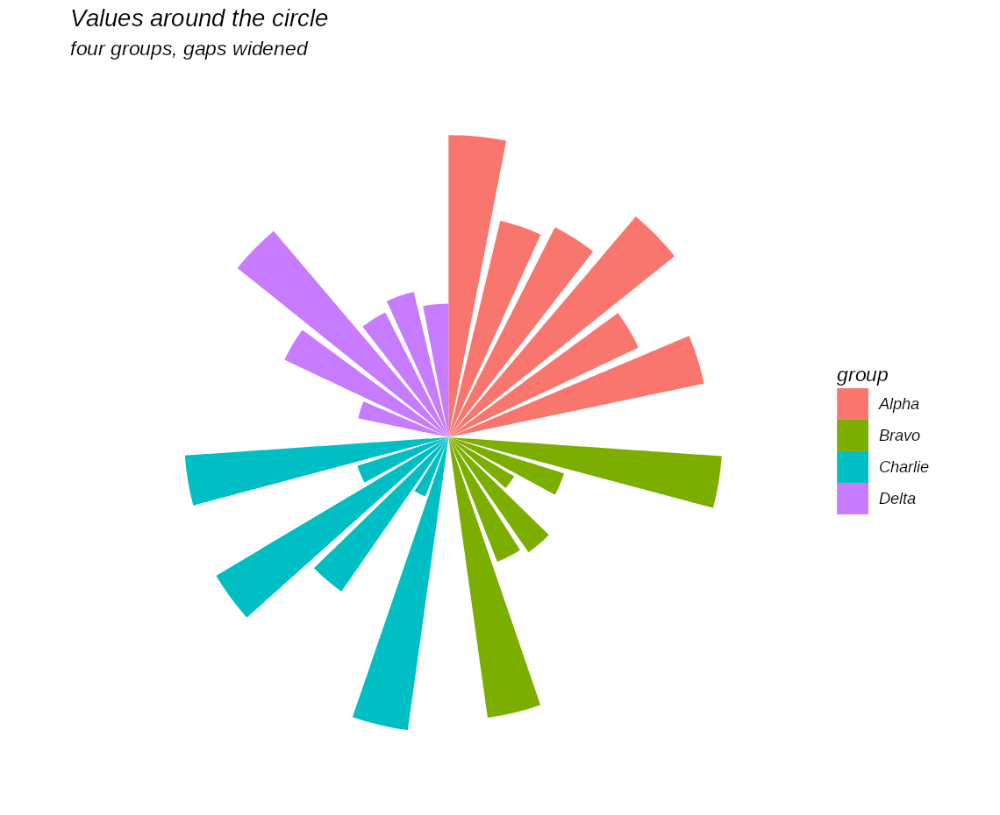
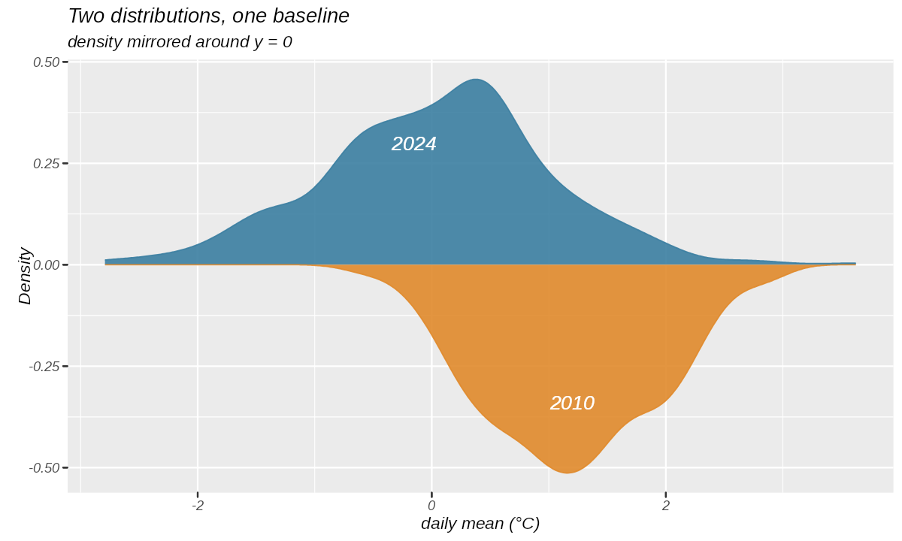

# gg4py

A Python port of **ggplot2 4.0.3** — the grammar of graphics rebuilt from scratch, with its
own intermediate representation and its own renderers (skia → PNG/SVG/PDF on the desktop,
TypeScript + DOM SVG in the browser). It is **not** a wrapper around matplotlib, plotnine or
any other plotting system: the grammar core depends on `numpy` alone.

中文版：[README.zh-CN.md](README.zh-CN.md)

## Install and first plot

Dependencies, environments and tasks are managed by [pixi](https://pixi.sh) (`pixi.toml`),
so there is nothing to `pip install`. Linux x86-64 for now.

```bash
pixi install
pixi run ggsave examples/heatmap/plot.py:plot my-first-plot.png
```

`ggsave` picks the device from the extension (`.png`, `.svg`, `.pdf`). The same plot from
Python — the data is any dict of columns, a pandas DataFrame or an Arrow table:

```python
from ggskia import ggsave  # skia backend: PNG / SVG / PDF
from ggcore.plot import aes, geom_point, ggplot, labs
from ggio.frame import from_dict

df = from_dict({"wt": [1.9, 2.6, 3.2, 3.5, 4.1], "mpg": [31, 26, 21, 18, 15]})
p = ggplot(df, aes(x="wt", y="mpg")) + geom_point(size=2) + labs(title="First plot")
ggsave(p, "first-plot.png", width=6, height=4, dpi=150)
```

## What it draws

Four examples, each a self-contained `plot.py` using nothing but gg4py itself
(`pixi run examples:<name>` regenerates the files below). Skipped references and the
capabilities they need are listed in [`docs/examples.md`](docs/examples.md).

**[Heatmap](examples/heatmap/plot.py)** — `geom_tile` + a viridis gradient over a
12-month × 8-year grid of synthetic temperatures.



**[Bump chart](examples/bump-chart/plot.py)** — `geom_line` + `geom_point` with
`scale_y_reverse()`, so rank 1 sits at the top and crossings stay readable.



**[Circular barplot with groups](examples/circular-barplot/plot.py)** — bars on a continuous
axis with a gap between groups, rolled into a ring by `coord_polar()`.



**[Mirrored density](examples/mirrored-density/plot.py)** — two densities sharing a zero
baseline: one drawn from `after_stat("density")`, the other from `after_stat("-density")`.



## How it works

| Layer | Responsibility |
| --- | --- |
| `src/ggcore/` | The grammar: aes, stats, geoms, scales, coords, facets, guides, themes. Pure Python + numpy, no pandas, no plotting library. Also runs in the browser under Pyodide. |
| IR (`ggcore.ir`) | Resolved geometry in float32 buffers, serialized as canonical CBOR. The single hand-off between the core and every renderer. |
| `src/ggio/` | Input adapters: pandas / Arrow / dict of arrays → one columnar table. |
| `src/ggskia/` | skia-python device → PNG / SVG / PDF for desktop and server rendering. |
| `web/viewer/` | TypeScript + DOM SVG viewer for the browser — no wasm, no bundler. |
| `src/ggdiff/` | Differential testing: R reference vs. our output, one rasterizer (resvg), pixel and ink metrics. |

The core is checked, not just claimed: X1 gates forbid any import outside
`numpy`/stdlib/`contourpy` inside `ggcore`, and the same plot produces byte-identical IR on
CPython and Pyodide. Rendering parity is measured against 311 upstream SVG snapshots
generated by ggplot2 4.0.3 itself, plus the browser viewer's DOM output.

## Development

```bash
pixi run check     # lint + tests + gates + viewer parity (what CI runs)
pixi run test      # pytest
pixi run lint      # ruff check + ruff format --check
```

Layout, environments and the full task catalogue: [`docs/dev/layout.md`](docs/dev/layout.md).
Reference reading (module-by-module contracts, gates, snapshot policy): [`docs/README.md`](docs/README.md).

## License

MIT — see [`LICENSE`](LICENSE). © 2026 Sylens Wong.

## Attribution

gg4py is a Python port of [ggplot2](https://github.com/tidyverse/ggplot2) **4.0.3**
(commit `cc1444c10edb87650fbe0cb31d56f0da1a255634`, tag `v4.0.3`), © 2025 ggplot2 core
developer team, MIT. The grammar semantics, the R-side reference fixtures and the reference
plots in `docs/cases/` are ported from or generated by that project; its copyright notice is
reproduced here, as the MIT license requires. Third-party asset inventory:
[`docs/notes/licenses.md`](docs/notes/licenses.md) (fonts, wasm and browsers are fetched at
build time by pixi / npm, never committed).
