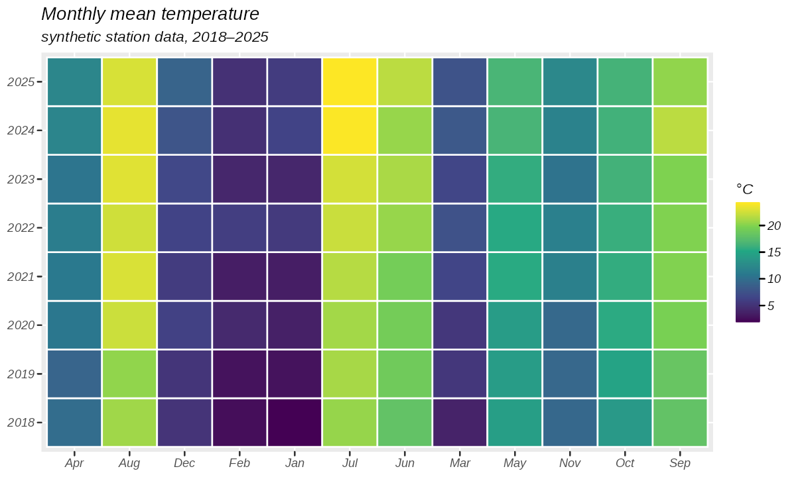
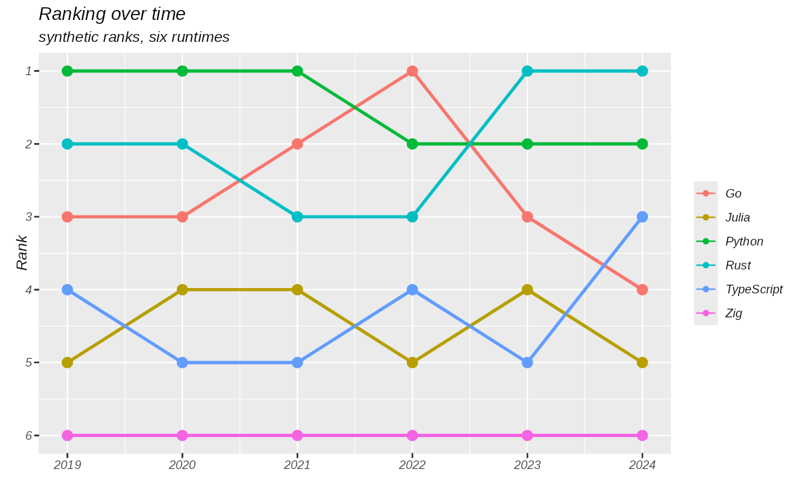
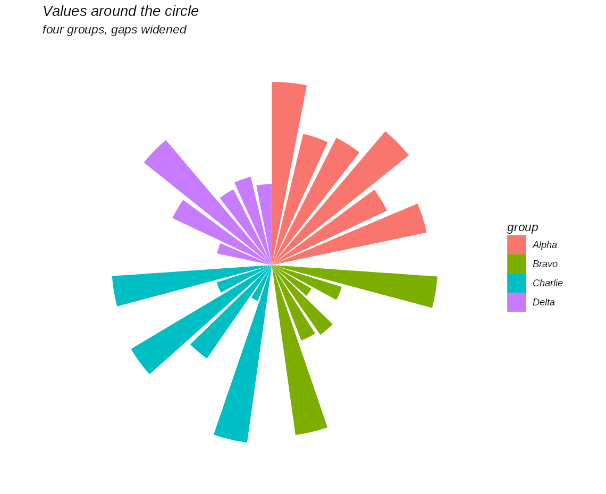
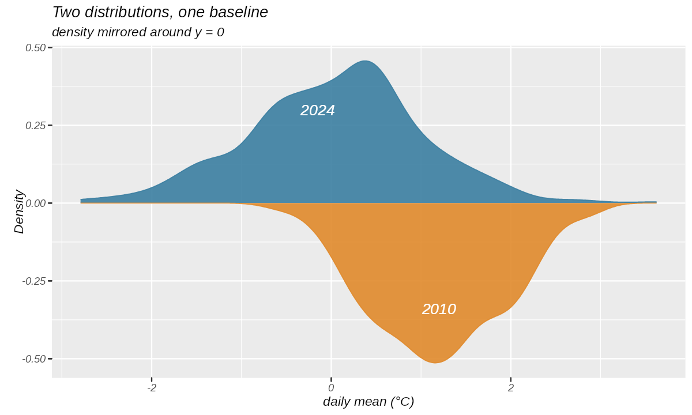

# gg4py

Python 下对 **ggplot2 4.0.3** 的对等复刻：图形语法从零实现，自带 IR 与渲染器（桌面走
skia，出 PNG / SVG / PDF；浏览器走 TypeScript 直接生成 DOM SVG）。它不是 matplotlib /
plotnine 之类的「语法封装」——内核只依赖 `numpy`，画出来的东西由自己的几何、标度、主题
与设备一步步算出来。

English version: [README.md](README.md)

## 安装与第一张图

依赖、环境、任务都由 [pixi](https://pixi.sh) 管（`pixi.toml`），不需要 `pip install`。
目前只支持 Linux x86-64。

```bash
pixi install
pixi run ggsave examples/heatmap/plot.py:plot my-first-plot.png
```

输出格式由后缀决定（`.png` / `.svg` / `.pdf`）。同一张图在 Python 里长这样，数据可以是
dict of columns、pandas DataFrame 或 Arrow 表——一条 import 就是整套 `library(ggplot2)`
的公开面：

```python
import gg4py  # ggplot、aes、全部 geom_*/stat_*/scale_*、from_*、ggsave

df = gg4py.from_dict({"wt": [1.9, 2.6, 3.2, 3.5, 4.1], "mpg": [31, 26, 21, 18, 15]})
p = (
    gg4py.ggplot(df, gg4py.aes(x="wt", y="mpg"))
    + gg4py.geom_point(size=2)
    + gg4py.labs(title="第一张图")
)
gg4py.ggsave(p, "first-plot.png", width=6, height=4, dpi=150)
```

分层——`gg4py.io` / `gg4py.ir` / `gg4py.diff` 放 IR、codec 与差分这类开发者 API——见
[`docs/notes/public-api.md`](docs/notes/public-api.md)；原来的 `from ggcore.plot import …`
写法继续有效。

## 能画什么

下面四张图各自是一个独立的 `plot.py`，只用了 gg4py 自己（`pixi run examples:<名字>` 可
原样重画）。没画出来的参考图、以及它们缺什么能力，记在
[`docs/examples.md`](docs/examples.md)。

**[热图](examples/heatmap/plot.py)** —— `geom_tile` 铺 12 个月 × 8 年的合成气温，
`scale_fill_viridis_c()` 上渐变。



**[排名变化图](examples/bump-chart/plot.py)** —— `geom_line` + `geom_point`，
`scale_y_reverse()` 把第 1 名翻到顶部，交叉关系一眼能看出来。



**[分组环形柱状图](examples/circular-barplot/plot.py)** —— 柱子排在一条连续轴上、组
与组之间留空位，再由 `coord_polar()` 卷成一圈。



**[镜像密度图](examples/mirrored-density/plot.py)** —— 两条密度曲线共用 y = 0 的基线：
一条用 `after_stat("density")` 画在上方，另一条用 `after_stat("-density")` 画在下方。



## 实现分层

| 层 | 职责 |
| --- | --- |
| `src/ggcore/` | 语法核心：aes、stat、geom、标度、坐标、分面、guide、主题。纯 Python + numpy，不依赖 pandas，也不依赖任何绘图库；同一份代码能在 Pyodide 里跑。 |
| IR（`ggcore.ir`） | 已解析的几何，float32 缓冲区 + canonical CBOR。内核与所有渲染器之间唯一的交接格式。 |
| `src/ggio/` | 输入适配：pandas / Arrow / dict of arrays → 同一张列式表。 |
| `src/ggskia/` | skia-python 设备 → PNG / SVG / PDF，桌面与服务端渲染走这条腿。 |
| `web/viewer/` | 浏览器查看器：TypeScript 直接生成 DOM SVG，零 wasm、零打包器。 |
| `web/editor/` | 浏览器代码编辑器：CodeMirror 6 + Pyodide 执行 + 同一个 DOM SVG 渲染器，导出 SVG / PNG / JPG。一个静态页面，无后端（[docs/notes/editor.md](docs/notes/editor.md)）。 |
| `src/ggdiff/` | 对拍：R 参考图 × 实测图，统一用 resvg 栅格化，比像素也比墨量。 |

这些边界不是口头约定：X1 门禁把 `ggcore` 能 import 的包限制在标准库 / numpy /
contourpy 之内；同一张图在 CPython 与 Pyodide 上产出的 IR 逐字节相同；渲染结果
与 ggplot2 4.0.3 自己生成的 311 份上游 SVG 快照逐张比对，浏览器查看器的 DOM 输出也纳入
同一套对拍。

## 开发

```bash
pixi run check     # lint + 测试 + 门禁 + 查看器对拍（CI 跑的就是它）
pixi run test      # pytest
pixi run lint      # ruff check + ruff format --check
```

目录职责、环境与全部任务：[`docs/dev/layout.md`](docs/dev/layout.md)。使用指南（一页一个
模块，每段代码都由 `pixi run docs:guide` 执行）：[`docs/guide/`](docs/guide/index.md)，
从 R 迁过来先看 [R → Python 对照表](docs/guide/r-to-python.md)。实现口径、门禁、
快照策略等逐份文档：[`docs/README.md`](docs/README.md)。

## 开发方式

仓库里的设计、代码、测试与文档全部由**同一个模型**产出——**DeepSeek**
（[deepseek-ai](https://github.com/deepseek-ai)）——经由下面这几个开源工具协作完成：

- [OpenCode](https://github.com/anomalyco/opencode)：终端里的编码 agent
- [Reasonix](https://github.com/esengine/DeepSeek-Reasonix)：编码 agent
- [Codex](https://github.com/openai/codex)：OpenAI 的终端编码 agent
- [Multica](https://github.com/multica-ai/multica)：任务看板与 agent 编排

## 许可证

MIT，全文见 [`LICENSE`](LICENSE)。© 2026 Sylens Wong。

## 致谢与归属

本项目是 [ggplot2](https://github.com/tidyverse/ggplot2) **4.0.3**（commit
`cc1444c10edb87650fbe0cb31d56f0da1a255634`，tag `v4.0.3`，© 2025 ggplot2 core developer
team，MIT）的 Python 对等复刻：语义层、R 侧参考夹具与 `docs/cases/` 里的参考图，移植或
生成自上游，其版权声明按 MIT 要求在此保留。第三方资产盘点见
[`docs/notes/licenses.md`](docs/notes/licenses.md)（字体 / wasm / 浏览器都是构建期由
pixi、npm 取的，不入库）。
